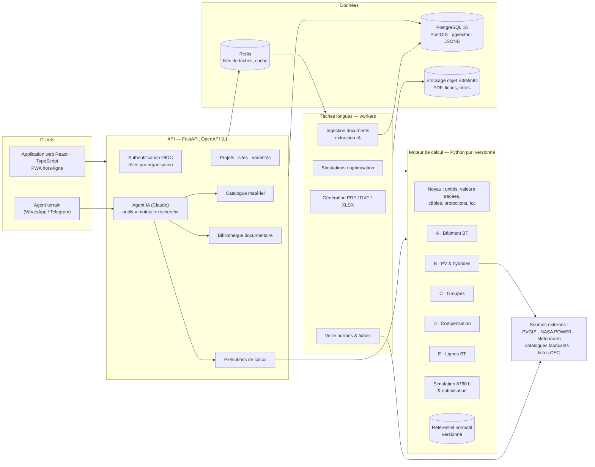
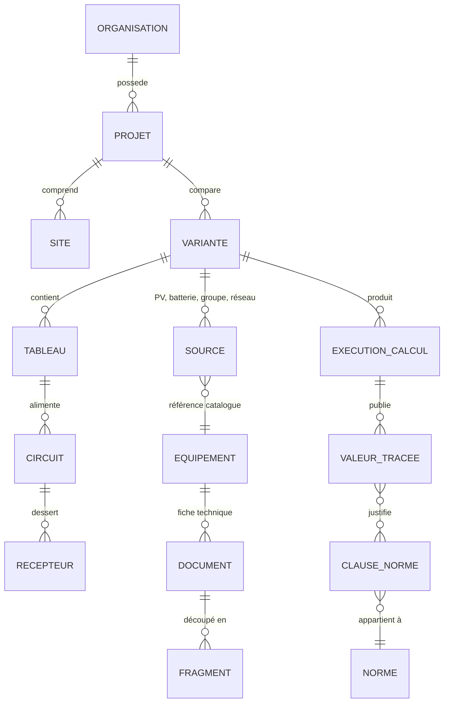
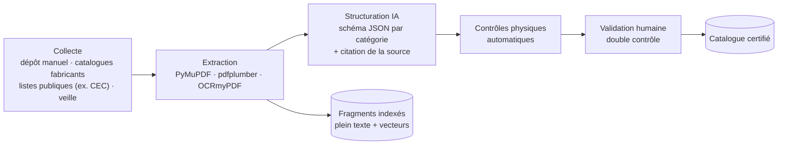

# 1. Architecture logicielle

Logiciel expert de calcul, d'audit et de dimensionnement électrotechnique : bâtiments BT, photovoltaïque et systèmes hybrides, groupes électrogènes, compensation, lignes aériennes BT.

---

## 1.1 Six principes directeurs

| # | Principe | Conséquence concrète |
|---|----------|----------------------|
| 1 | **Le moteur calcule, l'IA ne calcule jamais.** | Chaque nombre d'une note de calcul sort d'une fonction déterministe et versionnée. L'IA (Claude) comprend la demande, extrait les fiches techniques, cherche dans les documents et explique, mais elle appelle le moteur par des outils et ne produit aucune valeur elle-même. C'est la condition pour qu'une note soit opposable devant un bureau de contrôle. |
| 2 | **Traçabilité totale** | Un résultat n'est pas un nombre seul. Il porte sa valeur, son unité, sa formule, sa référence normative (norme, édition, article ou tableau), les hypothèses utilisées, la version du moteur et celle du référentiel. Une exécution de calcul est immuable et rejouable (empreinte des entrées). |
| 3 | **Le référentiel normatif est une donnée, pas du code** | Les tables (Iz, facteurs de correction, ks, coefficients k) vivent dans des fichiers versionnés. Chaque table indique sa norme, son édition, son numéro de tableau, son statut de validation et son valideur. Une nouvelle édition de norme donne une nouvelle version du référentiel, et les anciens projets gardent la leur. |
| 4 | **Aucune valeur par défaut cachée** | Toute valeur par défaut est une hypothèse nommée, visible dans la note et modifiable : coefficient d'extension, DoD, x'd, déclassement… |
| 5 | **Hors-ligne d'abord** | Les audits se font souvent sur des sites sans réseau. L'interface est une PWA et le moteur peut s'exécuter localement (Pyodide/WebAssembly ou application de bureau). |
| 6 | **Modularité par domaine** | Les modules A à E sont des paquets indépendants. Ils partagent un noyau commun : unités, modèle de réseau, câbles et protections, courts-circuits, rapport. |

Le démonstrateur [`demo_hybride.py`](../demo_hybride.py) applique déjà les principes 1, 2 et 4. Chaque valeur publiée renvoie à une justification `[Rn]`.

---

## 1.2 Vue d'ensemble



---

## 1.3 Choix techniques

| Couche | Choix recommandé | Pourquoi |
|--------|------------------|----------|
| **Moteur de calcul** | Python 3.12+, `numpy`, `scipy`, `pint` (unités), **`pvlib`** (géométrie solaire, modèle de Perez, températures de cellule), **`pandapower`** (répartition des charges, courts-circuits IEC 60909) | Écosystème scientifique de référence. `pvlib` et `pandapower` sont sous licence BSD (usage commercial possible) et déjà validés par la communauté. Une simulation 8760 h vectorisée prend moins de 50 ms. |
| **API** | FastAPI + Pydantic v2 | Validation stricte des entrées à la frontière, OpenAPI généré automatiquement, même langage que le moteur. |
| **Tâches longues** | Dramatiq ou Celery + Redis | Optimisation de milliers de variantes, ingestion de PDF, génération de rapports. |
| **Base de données** | PostgreSQL 16 + **PostGIS** (sites GPS, tracés de lignes, poteaux) + **pgvector** (recherche sémantique) + JSONB (caractéristiques matériel hétérogènes) | Une seule base pour le relationnel, le géographique et le vectoriel. Ajouter TimescaleDB si l'on importe des campagnes de mesure (audits). |
| **Stockage de fichiers** | S3 ou MinIO (sur site) | Fiches techniques, normes sous licence (isolées par organisation), notes générées. |
| **Recherche** | Plein texte PostgreSQL (configuration `french`) + pgvector (recherche hybride) ; OpenSearch si le volume l'exige | Pas d'infrastructure supplémentaire au démarrage. |
| **Interface** | React + TypeScript (Vite), TanStack Query, grille éditable pour l'inventaire des récepteurs, **React Flow** pour le schéma unifilaire, **MapLibre GL** pour le site et le tracé des lignes, ECharts pour les courbes (profils, SOC, courbes de déclenchement) | Saisie rapide de centaines de récepteurs, schéma interactif relié au modèle de calcul. |
| **Rapports** | Typst ou WeasyPrint (PDF), `ezdxf` (schéma unifilaire DXF pour AutoCAD), `openpyxl` (carnet de câbles XLSX), `python-docx` (version modifiable) | La note PDF est le livrable du bureau de contrôle. Le DXF et le XLSX sont les livrables du chantier. |
| **IA** | API Claude avec utilisation d'outils : `claude-opus-5-5` pour l'agent, `claude-haiku-5-5` pour l'extraction en masse des fiches (Batch API) | Voir §1.7. |
| **Déploiement** | MVP : `docker compose` (API, worker, Postgres, Redis, MinIO, front) sur un serveur ou sur site. V1+ : Kubernetes, OpenTelemetry, CI GitHub Actions | Les bureaux d'études veulent souvent une installation sur leur propre infrastructure. |

---

## 1.4 Le moteur de calcul

### Organisation des paquets

```
moteur/
├── noyau/            Valeur tracée (valeur, unité, formule, références, entrées), hypothèses, erreurs
├── referentiel/      Tables normatives versionnées (YAML) + chargeur + contrôle d'intégrité
│   └── v2026.1/      iec60364_5_52_B52.yaml, nfc15100_k3.yaml, iec61439_2_t101.yaml, ...
├── reseau/           Modèle en graphe : sources, tableaux, liaisons, récepteurs
├── cables/           Iz corrigé, ΔU, contrainte thermique, choix de section (partagé par A, B, C, E)
├── protections/      Disjoncteurs, fusibles, courbes temps-courant, sélectivité, Icc (IEC 60909)
├── module_a_batiment/
├── module_b_pv/      Gisement, champ, chaînes, batteries, onduleurs/chargeurs
├── module_c_groupe/
├── module_d_compensation/
├── module_e_lignes/  Mécanique des conducteurs, supports, Icc et ΔU le long de la ligne
├── simulation/       Bilan horaire 8760 h, stratégies de pilotage, optimisation multi-variantes
└── rapport/          Note de calcul, nomenclature, schémas
```

### Contrat de chaque module

```python
def calculer(entrees: EntreesModule, referentiel: Referentiel) -> ResultatTrace: ...
```

* **Fonctions pures** : aucune entrée/sortie, aucun accès réseau ni base. Le moteur est donc testable, rejouable et exécutable hors-ligne.
* **`ResultatTrace`** contient les valeurs tracées, les vérifications (OK / ATTENTION / NON CONFORME) et la liste des hypothèses. Dans l'interface, un clic sur une valeur affiche sa formule, ses entrées et la clause de norme correspondante.
* **Versionnement sémantique** du moteur. Chaque exécution stocke `version_moteur`, `version_referentiel` et l'empreinte SHA-256 des entrées.

### Méthode de calcul en deux temps (modules B et C)

1. **Pré-dimensionnement analytique** sur le mois critique : formules du [recueil d'équations](02-equations-modules-A-B-C.md).
2. **Vérification par simulation horaire** sur une année type : énergie non servie, heures de marche et carburant du groupe, cycles batterie, taux de charge du groupe au sens ISO 8528-1.

Une optimisation par balayage des variantes PV × batterie × groupe vient en V1. Elle minimise le coût actualisé (NPC/LCOE) sous contrainte de fiabilité.

---

## 1.5 Modèle de données (extrait)



```sql
CREATE TABLE execution_calcul (
  id                  uuid PRIMARY KEY,
  variante_id         uuid REFERENCES variante(id),
  module              text NOT NULL,              -- 'A', 'B', 'C', 'hybride', ...
  version_moteur      text NOT NULL,              -- '1.4.2'
  version_referentiel text NOT NULL,              -- 'v2026.1'
  empreinte_entrees   char(64) NOT NULL,          -- SHA-256 : rejouabilité
  entrees             jsonb NOT NULL,
  resultats           jsonb NOT NULL,             -- valeurs tracées + vérifications
  statut              text NOT NULL,              -- 'conforme', 'reserves', 'non_conforme'
  cree_par            uuid, cree_le timestamptz DEFAULT now()
);

CREATE TABLE equipement (
  id              uuid PRIMARY KEY,
  categorie       text NOT NULL,                 -- 'module_pv', 'onduleur', 'batterie', 'groupe', 'disjoncteur', ...
  fabricant       text NOT NULL,
  modele          text NOT NULL,
  caracteristiques jsonb NOT NULL,               -- schéma validé par catégorie
  certifications  text[],                        -- 'IEC 61215', 'IEC 61730', 'IEC 62109-1', 'IEC 62619', 'ISO 8528'
  statut          text NOT NULL DEFAULT 'brouillon', -- brouillon → verifie → valide → certifie
  provenance      jsonb,                         -- document, page, extrait cité pour chaque champ
  valide_par      uuid, valide_le timestamptz,
  UNIQUE (fabricant, modele)
);

CREATE TABLE fragment (                          -- recherche documentaire
  id          uuid PRIMARY KEY,
  document_id uuid REFERENCES document(id),
  page        int,
  clause      text,                              -- '525', 'Tab. B.52.17', ...
  texte       text,
  plein_texte tsvector GENERATED ALWAYS AS (to_tsvector('french', texte)) STORED,
  embedding   vector(1024)
);
```

---

## 1.6 API (REST, `/api/v1`)

| Méthode | Ressource | Rôle |
|---------|-----------|------|
| `POST` | `/projets`, `/projets/{id}/variantes` | Créer un projet et ses variantes |
| `POST` | `/sites` | Créer un site (GPS, altitude, climat) ; le gisement est récupéré et mis en cache (PVGIS / NASA POWER) |
| `GET` | `/sites/{id}/gisement` | Irradiations mensuelles ou année type horaire (TMY) |
| `POST` | `/calculs` | Lancer un calcul `{module, entrees, version_referentiel}` → `202 Accepted` + identifiant |
| `GET` | `/calculs/{id}` | Résultats tracés, vérifications, hypothèses |
| `GET` | `/calculs/{id}/note.pdf` · `/schema.dxf` · `/cables.xlsx` | Livrables |
| `POST` | `/calculs/{id}/rejouer` | Rejouer avec un autre référentiel ou une autre version du moteur (comparaison) |
| `GET` | `/catalogue?categorie=module_pv&statut=certifie` | Recherche de matériel |
| `POST` | `/catalogue/import` | Déposer une fiche PDF → extraction → brouillon à valider |
| `GET` | `/documents/recherche?q=…` | Recherche hybride avec citations (document, page, clause) |
| `POST` | `/agent/conversations/{id}/messages` | Agent IA (réponse en flux SSE) |
| — | Webhooks `calcul.termine`, `veille.nouvelle_edition`, `catalogue.fiche_modifiee` | Intégrations |

Les calculs sont idempotents : la même empreinte d'entrées avec le même référentiel donne le même résultat, servi depuis le cache.

---

## 1.7 Moteur documentaire et veille

### Chaîne de traitement



### Extraction automatique des fiches techniques

* Pour chaque catégorie (module PV, onduleur, régulateur, batterie, groupe, disjoncteur, câble), un **schéma JSON strict** définit les champs à extraire. Exemple pour un module PV : `Pmax, Vmp, Imp, Voc, Isc, γ, βVoc, αIsc, NOCT, I_RM, Vsys max, dimensions, certifications`.
* L'extraction utilise Claude avec sorties structurées. **Chaque champ conserve sa provenance** (document, page, texte cité), et le relecteur voit la source à côté de la valeur extraite.
* **Contrôles physiques automatiques** avant toute validation humaine :

| Catégorie | Règles de cohérence |
|-----------|---------------------|
| Module PV | \|Vmp·Imp − Pmax\| / Pmax ≤ 2 % ; Voc > Vmp ; Isc > Imp ; facteur de forme Pmax/(Voc·Isc) ∈ [0,70 ; 0,85] ; βVoc ∈ [−0,40 ; −0,20] %/°C ; NOCT ∈ [40 ; 50] °C |
| Onduleur | ηmax ≤ 99 % ; plage MPPT incluse dans Vdc max ; surcharge ≥ puissance continue |
| Batterie | Wh ≈ V·Ah (± 3 %) ; cycles cohérents avec la DoD annoncée ; plages de température de charge présentes |
| Groupe | ESP ≈ 1,1 × PRP ; kW = 0,8 × kVA ; consommation à 100 % entre 0,20 et 0,35 L/kWh |
| Disjoncteur | Icu ≥ Ics ; In dans la série normalisée ; courbe déclarée |

* Cycle de vie : **brouillon** (extrait) → **vérifié** (règles respectées) → **validé** (relu par une personne) → **certifié** (certificat ou rapport d'essai joint, avec date d'expiration). Seul le matériel validé ou certifié peut entrer dans une note destinée à un bureau de contrôle.

### Bibliothèque de normes et justification des résultats

* **Droits d'auteur :** les textes AFNOR, IEC et IEEE sont protégés. Le logiciel ne doit pas les redistribuer. Le référentiel partagé ne contient que des **références** (code, édition, article ou tableau) et les tables numériques saisies sous licence. Les PDF des normes sont déposés par chaque organisation à partir de ses propres abonnements et restent isolés par organisation.
* Chaque valeur tracée renvoie à une ou plusieurs clauses. La note PDF comprend une annexe « Justifications » : normes avec éditions, formules, hypothèses, données d'entrée et vérifications. Le démonstrateur la produit déjà sous forme de liste `[Rn]`.
* Sources ouvertes à intégrer dès le départ :
  * PVGIS (JRC) et NASA POWER pour le gisement solaire ;
  * listes publiques d'équipements certifiés (par exemple les listes de modules et d'onduleurs de la California Energy Commission) ;
  * guides techniques publics des fabricants et des agences (Guide de l'installation électrique Schneider Electric, IEA PVPS, ESMAP pour les mini-réseaux).

### Veille

* Surveillance des nouvelles éditions et amendements (catalogues IEC et AFNOR, textes réglementaires) et des révisions de fiches fabricants (empreinte du PDF).
* Toute nouvelle édition crée un **ticket de mise à jour du référentiel**. Les projets concernés sont signalés et peuvent rejouer leur calcul pour comparer les deux versions.

### Agent IA (couche conversationnelle)

* **Outils exposés à Claude :** `rechercher_documents`, `lire_clause`, `rechercher_materiel`, `calculer_bilan`, `dimensionner_pv`, `dimensionner_batteries`, `dimensionner_groupe`, `simuler_hybride`, `verifier_liaison`, `generer_note`.
* **Règles de l'agent :**
  * toute valeur chiffrée provient d'un outil ;
  * toute affirmation normative cite un fragment (document, page, clause) ;
  * s'il ne trouve pas la source, il le dit ;
  * il n'écrit jamais dans le catalogue sans validation humaine.
* Pour la veille sur le web, l'agent utilise l'outil de recherche web côté serveur, restreint à une liste de domaines autorisés (fabricants, organismes de normalisation).
* Le dépôt contient déjà un agent Claude multicanal (WhatsApp, Telegram). À terme, un technicien sur le terrain pourra interroger le moteur depuis son téléphone (feuille de route V2).

---

## 1.8 Qualité, validation et sécurité

* **Tests unitaires** de chaque formule contre des exemples publiés (le démonstrateur vérifie par exemple l'exemple 1.10.1 de Duffie & Beckman).
* **Tests de propriétés** (Hypothesis) :
  * la section ne diminue jamais quand la longueur augmente ;
  * l'énergie se conserve dans la simulation ;
  * l'état de charge reste entre ses bornes.
* **Tests de non-régression** sur des notes complètes (« fichiers de référence »).
* **Validation croisée** sur 20 à 30 projets réels, comparés aux logiciels du marché : Caneco BT ou Ecodial pour la BT, PVsyst ou HOMER pour l'hybride. Tolérances cibles :
  * sections identiques ;
  * ΔU à ± 0,1 point ;
  * Icc à ± 5 % ;
  * productible à ± 5 %.
* **Revue normative signée** par un ingénieur qualifié pour chaque version du référentiel.
* **Sécurité** : rôles par organisation, isolation des documents sous licence, journal d'audit, chiffrement au repos, sauvegardes, conformité RGPD.

## 1.9 Organisation du dépôt (cible)

```
dimensionnement/
├── moteur/          paquet Python (voir §1.4) — publié en interne avec version
├── api/             FastAPI, schémas Pydantic, workers
├── web/             React + TypeScript (PWA)
├── referentiel/     tables normatives versionnées + procès-verbaux de validation
├── cas-reference/   projets de validation croisée + résultats attendus
├── docs/            architecture, recueil d'équations, feuille de route
└── deploy/          docker compose, manifestes Kubernetes
```
