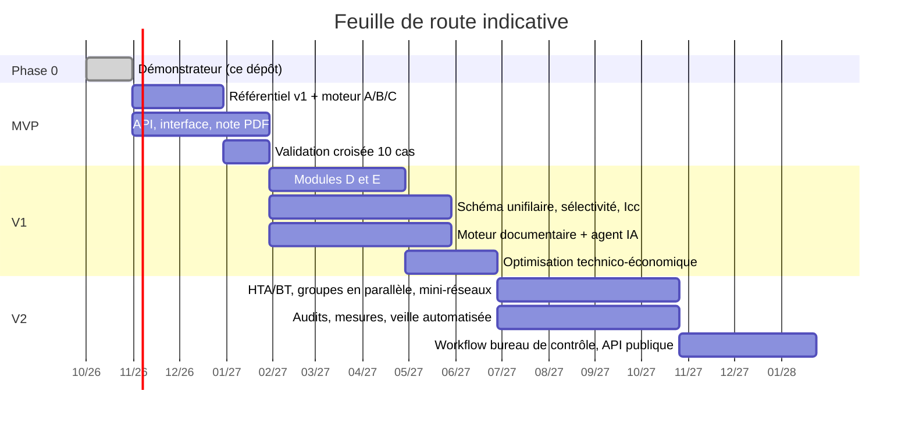

# 3. Feuille de route

Durées indicatives, pour une équipe resserrée :
* un ingénieur électricien senior, référent normatif, à temps partiel ;
* deux développeurs full-stack Python et TypeScript ;
* un profil UX/QA à mi-temps.

Chaque étape se termine par des **critères d'acceptation mesurables**.

---

## Phase 0 — Démonstrateur et application prototype (fait)

* [`demo_hybride.py`](../demo_hybride.py) : chaîne complète bilan → PV → batteries → onduleur → groupe → simulation 8760 h → câbles et protections, avec note de calcul justifiée.
* [`app/`](../app/) : **application de dimensionnement avec son agent IA**.
  * Quatre référentiels : NF C 15-100, IEC 60364, BS 7671 et NEC (NFPA 70).
  * Sept réseaux : 50 Hz (400/230, 380/220, 415/240 V, 230 V mono) et 60 Hz (120/240, 208Y/120, 480Y/277 V). Sections en mm² ou en AWG/kcmil selon la norme.
  * Le moteur JavaScript donne, en NF C 15-100, les mêmes résultats que le démonstrateur Python ; un test le vérifie.
  * Quatre types de système : hybride, solaire autonome, groupe seul, réseau public avec groupe de secours facultatif.
  * Modules D et E en première version :
    * compensation de l'énergie réactive, choix selon les harmoniques, rang de résonance ;
    * ligne aérienne BT : changement d'état, flèches, classes de poteaux, ΔU et Icc le long de la ligne.
  * Onglets :
    * projet ;
    * charges avec bibliothèque d'appareils ;
    * choix techniques ;
    * ligne aérienne ;
    * résultats et comparaison des systèmes ;
    * note de calcul téléchargeable.
  * L'assistant Claude choisit la norme du pays, remplit le projet, calcule et explique.
* 41 tests automatiques :
  * 18 sur le démonstrateur Python ;
  * 23 sur le moteur de l'application : parité, conservation de l'énergie, systèmes, validation des saisies, cas types NEC et BS 7671, compensation, ligne aérienne, toutes les combinaisons norme × réseau × système.
* Documents : architecture, recueil d'équations, cette feuille de route.

---

## MVP — environ 3 à 4 mois

**Objectif :** un bureau d'études produit, pour un bâtiment tertiaire ou résidentiel et un système PV + batteries + groupe, une note de calcul PDF justifiée qu'un ingénieur accepte de signer.

| Domaine | Contenu |
|---|---|
| Référentiel v1 | Tables IEC 60364-5-52 / NF C 15-100 (Iz pour les méthodes A1 à F, cuivre et aluminium, PVC et PR ; facteurs de température, de groupement et d'harmoniques ; k3 ; k adiabatique), IEC 61439-2 tab. 101, courbes B/C/D. Chaque table saisie sous licence, **relue et signée** par l'ingénieur référent. |
| Module A | Inventaire des récepteurs, ku/ks paramétrables, arborescence TGBT → TD → circuits, répartition des phases, sections (Iz, ΔU cumulée, contrainte thermique), disjoncteurs et fusibles, Icc max et min (méthode des impédances), vérification du déclenchement. |
| Module B | Gisement mensuel PVGIS / NASA POWER (avec cache), transposition, champ PV, chaînes et protections, batteries LFP et plomb, onduleur/chargeur, régulateurs, simulation horaire avec année type. |
| Module C | Critères de puissance (régime établi, recharge, démarrage), déclassement, taux de charge ISO 8528-1, consommation, Icc du groupe, inverseur de source. |
| Catalogue | Saisie manuelle et import CSV, environ 50 références par catégorie, statut « validé ». |
| Interface | Projets et variantes, site sur carte, grille d'inventaire, résultats avec « pourquoi ? » (formule et référence au clic), comparaison de variantes. |
| Livrables | Note de calcul PDF (hypothèses, résultats, vérifications, annexe de justifications), nomenclature, carnet de câbles XLSX. |
| Plateforme | API FastAPI, PostgreSQL, `docker compose`, authentification simple, sauvegardes. |

**Critères d'acceptation :**

* Couverture de tests du moteur ≥ 90 %. Toute formule est testée contre au moins un exemple publié.
* Dix cas de référence réels comparés à Caneco BT ou Ecodial (BT) et à PVsyst ou HOMER (hybride), avec les tolérances suivantes :
  * sections identiques ;
  * ΔU à ± 0,1 point ;
  * Icc à ± 5 % ;
  * productible à ± 5 % ;
  * heures de marche du groupe à ± 10 %.
* Note complète d'un projet de 200 récepteurs générée en moins de 10 s.
* Chaque valeur publiée porte au moins une justification (contrôle automatique, comme le test `test_toutes_les_references_sont_numerotees`).

---

## V1 — environ 4 à 6 mois de plus

**Objectif :** couvrir les cinq modules et automatiser la documentation technique.

| Domaine | Contenu |
|---|---|
| Module D | Le prototype calcule déjà la compensation, le type de condensateurs et la résonance. À ajouter : selfs anti-harmoniques au choix (accord 189 Hz / 135 Hz), calcul du THD, import des mesures d'un analyseur de réseau, validation sur cas réels. |
| Module E | Le prototype calcule déjà le changement d'état, les flèches, les supports béton et bois, ΔU et Icc. À ajouter : <ul><li>lignes ramifiées ;</li><li>catalogue certifié de conducteurs et de poteaux ;</li><li>supports métalliques et haubans calculés ;</li><li>tracé sur carte avec PostGIS.</li></ul> |
| Réseau | Schéma unifilaire éditable (React Flow) relié au modèle de calcul, répartition des charges et courts-circuits IEC 60909 avec `pandapower`, sélectivité à partir des courbes temps-courant des constructeurs. |
| Moteur documentaire | Ingestion de PDF, extraction structurée par IA avec provenance, contrôles physiques, validation humaine, catalogue certifié, recherche hybride avec citations. |
| Agent IA | Assistant conversationnel (Claude) dont les outils sont le moteur, la recherche documentaire et le catalogue. Il ne publie aucun chiffre sans outil et cite chaque clause. |
| Optimisation | Balayage des variantes PV × batterie × groupe : coût actualisé net (NPC), LCOE, CO₂, sensibilité au prix du carburant, contrainte de fiabilité (LLP). |
| Plateforme | Rôles et organisations, mode hors-ligne (PWA), exports DXF, notifications, journal d'audit. |

**Critères d'acceptation :**

* Modules D et E validés sur cinq cas de référence chacun.
* Extraction des fiches avec au moins 95 % des champs exacts après les contrôles automatiques, mesurés sur 100 fiches annotées. Aucun champ n'entre dans le catalogue sans validation humaine.
* L'agent répond juste, avec citations, sur un jeu d'évaluation de 50 questions normatives. Taux de citations erronées : 0 %.

---

## V2 — environ 6 à 9 mois de plus

| Domaine | Contenu |
|---|---|
| HTA/BT | Postes de livraison et de transformation, choix des transformateurs, protections HTA, Icc côté HTA. |
| Groupes | Groupes en parallèle (synchronisation, répartition de charge, N+1), centrales hybrides multi-groupes. |
| Mini-réseaux | Réseaux multi-villages : tracé, répartition des charges, plan de comptage, croissance de la demande. |
| Audit énergétique | Import de campagnes de mesure (courbes de charge, harmoniques), profils réels, recommandations chiffrées : compensation, remplacement de groupe, ajout de PV. |
| Veille | Surveillance automatique des éditions de normes et des révisions de fiches, impact signalé sur les projets existants, procédure de mise à jour du référentiel. |
| Conformité | Workflow de validation avec le bureau de contrôle (commentaires, réserves, levée), signature électronique des notes, archivage à valeur probante. |
| Intégrations | API publique, devis et ERP, maquette BIM (IFC), suivi après mise en service (production réelle comparée à la prévision). |
| Terrain | Application installable sur téléphone (PWA) avec relevé de site : photos des plaques signalétiques lues par l'assistant, coordonnées GPS, mode hors-ligne. |

---

## Risques principaux et parades

| Risque | Parade |
|---|---|
| Erreur de calcul engageant la responsabilité | Fonctions pures testées, validation croisée, référentiel signé, mention « à valider par un ingénieur qualifié », assurance RC professionnelle. |
| Droits d'auteur sur les normes | Ne stocker que des références et des tables saisies sous licence. Les PDF des normes restent isolés par organisation, achetés par l'utilisateur. |
| Qualité des données fabricants | Contrôles physiques, provenance de chaque champ, double validation, statut « certifié » seulement avec un justificatif. |
| Dispersion du périmètre | Feuille de route par jalons, avec critères d'acceptation chiffrés pour chaque étape. |
| Sites sans connexion | Moteur exécutable hors-ligne et synchronisation différée. |
| Normes locales différentes selon les pays | Référentiel paramétrable par pays (variantes nationales de l'IEC 60364, pratiques locales de distribution). |

---

## Prochaines actions (2 premières semaines)

1. **Choisir les marchés cibles parmi les quatre référentiels déjà en place** (NF C 15-100, IEC 60364, BS 7671, NEC). Ajouter si besoin les variantes nationales, par exemple CSA C22.1 au Canada ou les règles du distributeur local. Cela fixe le contenu du référentiel v1.
2. **Faire relire par l'ingénieur référent** toutes les tables et hypothèses du démonstrateur, et consigner les corrections.
3. **Réunir 5 à 10 projets réels déjà réalisés**, avec leurs notes de calcul, pour constituer les cas de validation croisée.
4. **Découper le démonstrateur** en paquet `moteur/` avec des modèles d'entrée Pydantic, sans changer les formules, et garder les tests verts.
5. **Brancher PVGIS et NASA POWER** (gisement mensuel et TMY), avec un cache par coordonnées.
