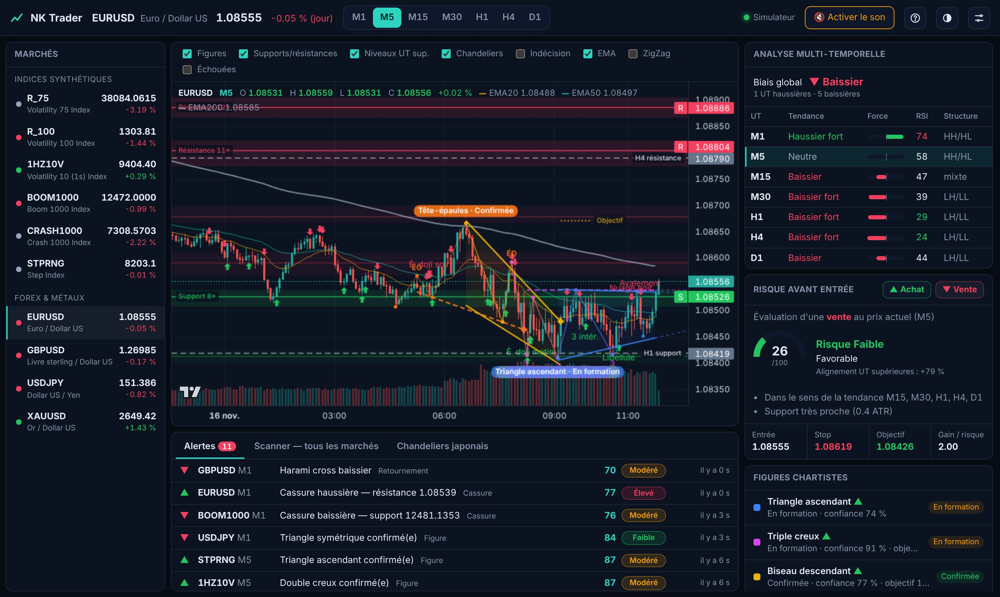

# NK Trader — scalping et analyse multi-temporelle en temps réel

Application de trading **d'analyse** (elle ne passe pas d'ordres) pour les **indices synthétiques**
(Volatility, Boom/Crash, Step Index…) et le **Forex**, de **M1 à D1** :

- flux temps réel : **Deriv** (WebSocket), **MetaTrader 5**, **webhooks TradingView**, ou **simulateur** hors ligne ;
- **chandeliers japonais** : ~35 figures natives (marteau, avalement, étoiles, trois soldats…) + les 61 de **TA-Lib** si installé ;
- **figures chartistes** détectées par **ZigZag + Ramer-Douglas-Peucker** : doubles/triples sommets et creux,
  tête-épaules (et inversée), triangles, biseaux, canaux, rectangles, drapeaux, fanions — **tracées sur le graphique** avec un code couleur ;
- **supports / résistances** majeurs (zones) et niveaux des unités de temps supérieures (H1/H4/D1) ;
- **analyse multi-temporelle** : chaque signal M1/M5 est croisé avec la tendance H1/H4/D1 → **score de risque**, stop, objectif, ratio gain/risque ;
- **alarmes sonores** en temps réel (retournement fort, cassure de niveau clé, figure validée), notifications visuelles et système.



> ⚠️ Outil d'aide à la décision, pas un conseil en investissement. Les indices synthétiques et le Forex à effet de
> levier comportent un risque élevé de perte. Testez toujours sur compte démo.

---

## Démarrage rapide

Il faut **Python 3.11 ou plus récent**.

```bash
cd trading
pip install -r requirements.txt
python run.py --open                  # simulateur hors ligne, ouvre le navigateur
```

Ou double-clic sur `DEMARRER.bat` (Windows) / `./demarrer.sh` (macOS, Linux) : un environnement Python
est créé automatiquement au premier lancement.

L'interface est sur **http://localhost:8000**. Cliquez sur **« Activer le son »** (les navigateurs exigent
un clic avant de jouer un son).

| Commande | Source des données |
|---|---|
| `python run.py` | Simulateur (aucune connexion nécessaire) |
| `python run.py --speed 60` | Simulateur accéléré : 1 minute simulée par seconde — idéal pour voir des alertes |
| `python run.py --provider deriv` | **Temps réel Deriv** : indices synthétiques + Forex, sans compte |
| `python run.py --provider mt5` | **MetaTrader 5** (Windows, terminal ouvert et connecté) |
| `python run.py --provider tradingview` | **Webhooks TradingView** |

Options : `--port 8080`, `--host 0.0.0.0`, `--config autre.toml`, `--debug`.

---

## Sources de données

### Deriv (recommandé pour les indices synthétiques)
API WebSocket publique (`wss://ws.derivws.com/websockets/v3`), aucune clé requise pour les cours.
Une souscription aux ticks par instrument ; les bougies M1…D1 sont construites localement, alignées sur
l'heure UTC exactement comme celles de Deriv. Reconnexion automatique avec rattrapage des bougies manquées.
Les noms Deriv sont dans `aliases.deriv` (`R_75`, `BOOM1000`, `stpRNG`, `frxEURUSD`…). Pour un usage
régulier, créez votre propre `app_id` sur https://api.deriv.com et mettez-le dans `config.toml`.

### MetaTrader 5
```bash
pip install MetaTrader5          # Windows uniquement
python run.py --provider mt5
```
Le terminal MT5 doit être ouvert et connecté (ou renseignez `login` / `password` / `server` dans
`[providers.mt5]`). Les bougies de chaque unité de temps sont lues directement dans MT5 : elles sont
identiques à celles du terminal (heure du serveur du courtier). Les noms de symboles sont dans
`aliases.mt5` (ex. `"Volatility 75 Index"` chez Deriv-MT5).

### Webhooks TradingView
1. Mettez un secret dans `config.toml` (`[providers.tradingview] secret = "..."`) ou dans la variable
   d'environnement `TV_WEBHOOK_SECRET`, et indiquez `provider = "tradingview"` sur les instruments concernés.
2. Sur un graphique **1 minute** TradingView, créez une alerte « Une fois par clôture de barre » avec
   l'URL `https://votre-adresse/api/webhook/tradingview` et ce message :
   ```json
   {"secret": "MON_SECRET", "symbol": "{{ticker}}", "tf": "{{interval}}", "time": "{{time}}",
    "open": {{open}}, "high": {{high}}, "low": {{low}}, "close": {{close}}, "volume": {{volume}}}
   ```
   Chaque bougie M1 reçue est fusionnée dans M5…D1. Un champ `"bars": [...]` permet d'envoyer un historique.
3. TradingView n'appelle que des adresses publiques (ports 80/443). N'exposez **que** le chemin
   `/api/webhook/tradingview` (tunnel ou proxy inverse) : l'interface elle-même n'a pas d'authentification.

### Simulateur
Reproduit le comportement statistique des indices Deriv (volatilité constante, pics Boom/Crash, pas fixes
du Step Index) et du Forex (volatilité selon les sessions Asie/Londres/New York). Toutes les unités de
temps dérivent d'une même trajectoire M1, donc parfaitement cohérentes.

---

## L'interface

- **Marchés** (gauche) : prix en direct, variation du jour, pastille de **biais multi-UT**.
- **Graphique** : bougies, volume (ticks), EMA 20/50/200, flèches de chandeliers japonais, zones de
  supports/résistances, niveaux H1/H4/D1 en tirets, figures chartistes. Cases à cocher pour tout afficher/masquer.
- **Analyse multi-temporelle** : tendance, force, RSI et structure (HH/HL, LH/LL) de M1 à D1 ; clic = changer d'UT.
- **Risque avant entrée** : boutons **Achat / Vente** pour évaluer une entrée au prix actuel ; jauge 0-100,
  verdict, raisons, stop, objectif et ratio gain/risque. Le risque du dernier signal s'affiche automatiquement.
- **Figures chartistes** et **Supports & résistances** : survol = mise en évidence sur le graphique, clic = centrer.
- **Alertes / Scanner / Chandeliers** : historique des alarmes, signaux de **tous** les marchés et toutes les UT
  (même non affichés), figures de chandeliers récentes. Clic = ouvrir le graphique au bon endroit.
- **Réglages** (icône curseurs) : score minimal, types d'alertes, unités de temps, risque maximal accepté,
  délai anti-répétition, volume, test des sons, notifications système.

### Code couleur

| Élément | Couleur |
|---|---|
| Doubles / triples sommets et creux | magenta |
| Tête-épaules | orange |
| Triangles | bleu |
| Biseaux | jaune |
| Canaux, rectangles | violet |
| Drapeaux, fanions | cyan |
| Support / résistance | zone verte / zone rouge |
| Niveau H1/H4/D1 | tirets gris clair |
| Chandelier haussier / baissier / indécision | ▲ vert / ▼ rouge / ● gris |

Trait plein = bornes de la figure, tirets = ligne de cou, pointillés = objectif, ◆ = point de cassure. Une figure
**en formation** est prolongée en pointillés ; elle devient **confirmée** à la clôture d'une bougie au-delà de sa
ligne de cassure (jamais sur une bougie en cours : pas de « repaint »).

### Sons

| Son | Évènement |
|---|---|
| 3 notes montantes | retournement / rejet haussier |
| 3 notes descendantes | retournement / rejet baissier |
| bips rapides | cassure de niveau clé |
| arpège | figure chartiste confirmée |

Les signaux très forts (score ≥ 85) sonnent deux fois. Une seule alerte par instrument et par bougie (les
autres signaux de la même bougie sont listés en « confluence »).

---

## Comment fonctionne l'analyse

À **chaque clôture de bougie** (M1…D1) de **chaque instrument**, le moteur (`app/analysis/engine.py`) :

1. **ZigZag** (`zigzag.py`) : un pivot est validé quand le prix repart de `1,6 × ATR(14)` dans l'autre sens
   → structure mineure. **Ramer-Douglas-Peucker** simplifie cette ligne brisée (tolérance `3 × ATR`)
   → structure majeure. Les figures sont cherchées sur les deux.
2. **Figures chartistes** (`chart_patterns.py`) : règles géométriques sur les pivots — égalité des sommets à
   `0,8 × ATR` près, profondeur minimale, symétrie temporelle des épaules, droites de régression des sommets et
   des creux (pente relative, convergence, résidus, % de clôtures hors bornes)… Statut : en formation →
   confirmée (clôture au-delà de la ligne de cou / borne) ou échouée (invalidation). Objectif = projection
   classique de la hauteur.
3. **Chandeliers japonais** (`candlesticks.py`) : détection vectorisée, avec contexte de tendance (un marteau
   n'existe qu'après une baisse). Les « gaps » des définitions classiques sont remplacés par des écarts entre
   corps, car ces marchés sont continus.
4. **Supports / résistances** (`levels.py`) : regroupement des pivots (récence, pivots majeurs, nombre de
   touches), zones espacées d'au moins `1,2 × ATR`, pondérées par la proximité du prix.
5. **Tendance** (`trend.py`) : prix/EMA50, EMA20/EMA50, pente de l'EMA50, EMA200, structure HH/HL, DMI, atténué si ADX < 18.
6. **Signaux** (`signals.py`), notés de 0 à 100 :
   retournement en chandelier (bonus sur support/résistance, niveau UT supérieure, RSI, confluence),
   cassure de niveau, rejet (longue mèche), figure confirmée. **Fort** à partir de 70.
7. **Risque multi-temporel** (`mtf.py`) : alignement pondéré avec les UT supérieures (poids dans
   `[mtf.weights]`, H1 et D1 dominants), volatilité extrême, RSI, distance au prochain obstacle, ratio gain/risque
   → score 0-100 : **faible** (< 35), **modéré** (< 60), **élevé**.

Les unités de temps supérieures sont analysées avant les inférieures quand elles clôturent ensemble, pour que
les signaux courts disposent toujours du contexte à jour. Une analyse complète prend ~10 ms.

---

## Architecture

```
trading/
├── run.py                     lancement (CLI)
├── config.toml                instruments, fournisseurs, paramètres d'analyse et d'alertes
├── app/
│   ├── main.py                FastAPI : API REST, WebSocket /ws, fichiers de l'interface
│   ├── config.py              lecture de config.toml + variables d'environnement
│   ├── core/                  modèles (Candle, Signal, ChartPattern…), unités de temps
│   ├── data/
│   │   ├── store.py           bougies en mémoire, agrégation ticks → M1…D1, détection des clôtures
│   │   └── providers/         simulator · deriv · mt5 · tradingview (interface DataProvider)
│   ├── analysis/              indicateurs, chandeliers, zigzag/RDP, figures, niveaux, tendance, MTF, signaux
│   └── services/
│       ├── market.py          orchestration temps réel (flux → stockage → analyse → diffusion)
│       ├── alerts.py          filtrage, anti-répétition, historique des alertes
│       └── clients.py         connexions WebSocket non bloquantes
├── static/                    interface (HTML/CSS/JS sans compilation, Lightweight Charts™ inclus)
└── tests/                     pytest
```

### Étendre l'application

- **Nouvel instrument** : ajouter un bloc `[[instruments]]` dans `config.toml` (`symbol`, `name`, `category`,
  `digits`, `aliases` par fournisseur, `provider` facultatif). Les instruments de fournisseurs différents
  peuvent cohabiter (ex. synthétiques via Deriv et Forex via MT5).
- **Nouvelle source** : une classe héritant de `DataProvider` décorée par `@register_provider("nom")`, importée
  dans `app/data/providers/__init__.py`. Elle implémente `load_history` et `subscribe`, et pousse les données
  avec `sink.on_tick(...)` ou `sink.on_bar(...)`.
- **Nouvelle figure de chandelier** : une fonction décorée par `@pattern(...)` dans `candlesticks.py`
  renvoyant `+1 / -1 / 2 (neutre) / 0` pour chaque bougie.
- **Nouvelle figure chartiste** : une fonction `(Bars, pivots, j) -> ChartPattern | None` ajoutée à la liste
  `candidates` de `chart_patterns.detect`.
- **Nouvel indicateur** : `analysis/indicators.py` (fonctions NumPy), puis l'utiliser dans `trend.py` ou
  `signals.py`, et l'ajouter à `AnalysisSnapshot` pour l'afficher.
- **Nouvelle unité de temps** : une entrée dans `Timeframe` (`core/timeframes.py`) et dans `config.toml`.

### API

| Méthode | Chemin | Rôle |
|---|---|---|
| GET | `/api/instruments` | instruments, prix, variation, biais |
| GET | `/api/candles/{symbole}/{ut}?limit=500` | bougies |
| GET | `/api/analysis/{symbole}/{ut}` | analyse complète (figures, niveaux, tendance, signaux) |
| GET | `/api/mtf/{symbole}` | matrice multi-temporelle |
| GET | `/api/risk/{symbole}/{ut}/{bullish\|bearish}` | évaluation du risque d'une entrée maintenant |
| GET | `/api/signals`, `/api/alerts` | derniers signaux / alertes |
| GET/PUT | `/api/settings/alerts` | règles d'alerte (enregistrées dans `data/alert_rules.json`) |
| GET | `/api/status`, `/api/catalog` | état des fournisseurs, liste des figures reconnues |
| POST | `/api/webhook/tradingview` | réception des alertes TradingView |
| WS | `/ws` | `subscribe` → `snapshot`, puis `candle`, `analysis`, `mtf`, `ticker`, `signals`, `alert`, `status` |

### Tests

```bash
cd trading
python -m pytest -q
```

Les tests couvrent l'agrégation des bougies, les chandeliers, le ZigZag/RDP, la détection des figures
(double sommet, tête-épaules, triangle…), les niveaux et cassures, le risque multi-temporel, les règles
d'alerte, et l'application complète (simulateur, WebSocket, webhooks TradingView).

---

## Limites connues

- Analyse et alertes uniquement : aucun ordre n'est envoyé au courtier.
- Les marchés Forex fermés (week-end) n'envoient plus de ticks ; l'historique reste consultable.
- La détection géométrique est volontairement stricte : moins de figures, mais plus propres. Les seuils sont
  réglables dans `[analysis]` (`zigzag_atr`, `rdp_atr`, `equal_tolerance_atr`).
- Le graphique utilise TradingView Lightweight Charts™ (licence Apache 2.0, logo TradingView affiché comme l'exige la licence).
