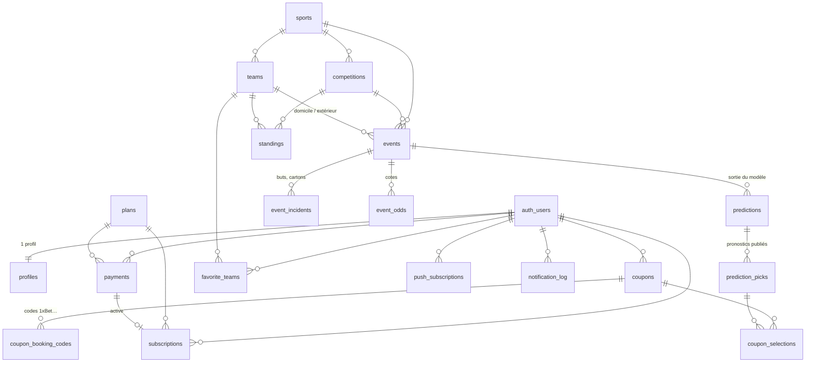

# Winner Pronostic — architecture

Ce document décrit la **base de données**, l'**arborescence du projet** et les **règles de sécurité**.
Le SQL de référence est dans [`supabase/migrations/`](../supabase/migrations).

---

## 1. Schéma de la base de données (Supabase / PostgreSQL)



### Utilisateurs

| Table | Rôle | Colonnes clés |
|---|---|---|
| `profiles` | 1 ligne par compte (créée automatiquement à l'inscription) | `display_name`, `email`, `phone`, `birth_date` (**contrainte ≥ 18 ans**), `country_code`, `role` (`user`/`admin`), préférences de notifications |

### Données sportives (synchronisées depuis API-Sports, phase 2)

Tous les sports partagent les mêmes tables. Les identifiants des fournisseurs ne sont uniques **que par sport** (la ligue 39 du football n'est pas la ligue 39 du basket) : chaque table a un identifiant interne et un couple unique `(sport, external_id)`. Des clés étrangères composites garantissent qu'un événement, sa compétition et ses équipes sont du même sport.

| Table | Rôle | Colonnes clés |
|---|---|---|
| `sports` | Sports proposés | `code` (football, basketball, ice_hockey, handball, volleyball, rugby, baseball, american_football, tennis), `name`, `emoji`, `has_draw`, `is_enabled` |
| `competitions` | Ligues et coupes | `sport`, `external_id`, `name`, `country_name`, `current_season`, `is_enabled`, `is_featured`, `display_order` |
| `teams` | Équipes (ou joueurs pour les sports individuels) | `sport`, `external_id`, `name`, `logo_url`, `elo_rating` |
| `events` | Matchs de tous les sports | `starts_at`, `status_short` (brut), `status_group` (scheduled / live / finished / postponed / cancelled), `live_clock` (« 67' », « Q3 04:12 »), scores, `period_scores` (mi-temps, quart-temps, périodes, sets) |
| `event_incidents` | Buts, cartons, pénalités… | `minute`, `period`, `type`, `detail`, `player_name` |
| `standings` | Classements | rang, points, marqués/encaissés **domicile et extérieur**, `form` |
| `event_odds` | Cotes des bookmakers | `market`, `line`, `selection`, `odd` |
| `api_cache` | Cache des réponses brutes (compos, blessés, H2H) | `cache_key`, `payload`, `expires_at` |
| `sync_runs` | Journal des tâches cron et du quota API | `job`, `status`, `api_requests` |

### Pronostics, historique et coupons (phases 4 et 5)

| Table | Rôle | Colonnes clés |
|---|---|---|
| `predictions` | Probabilités de **tous les marchés** pour un événement | `model_version`, `expected_home`, `expected_away` (buts/points attendus), `probabilities` (JSON), `inputs` |
| `prediction_picks` | Pronostics **publiés** = historique public | `sport`, `market`, `line`, `selection`, `probability`, `best_odd`, `edge` (value), `confidence` 1–5, `is_premium`, `result` |
| `coupons` | Coupons `generated` (« code de X »), `analyzed` ou `editorial` (admin, éventuellement premium) | `target_odds`, `risk_level`, `period`, `sports[]`, `total_odds`, `estimated_probability`, `analysis` |
| `coupon_selections` | Sélections d'un coupon (1 par événement) | `market`, `line`, `selection`, `odd`, `probability`, `result` |
| `coupon_booking_codes` | **Codes de chargement** d'un coupon chez un bookmaker | `bookmaker` (ex. `1xbet`), `country_code`, `code`, `expires_at` |

Chaque cote, pronostic et sélection de coupon porte une **période** (`FT` match entier, `1H`/`2H` mi-temps, `P1`–`P3` périodes de hockey, `Q1`–`Q4` quarts-temps, `S1`–`S5` sets), un **marché**, une **ligne** éventuelle et une **sélection**. Marchés : `1X2`, `DC`, `DNB`, `ML`, `TOTAL`, `TT1`/`TT2` (Total 1 / Total 2), `HCP`, `BTTS`, `CS` (score exact), `ODD_EVEN`, combinés `RES_TOTAL`, `RES_BTTS`, `DC_BTTS`, `DC_TOTAL`, `HTFT` (MT-Fin), mi-temps (`SCORE_BOTH_HALVES`, `TEAM_SCORE_BOTH_HALVES`, `WIN_BOTH_HALVES`, `WIN_EITHER_HALF`, `DRAW_BOTH_HALVES`, `HIGHEST_HALF`), temps de jeu (`FIRST_GOAL`, `GOAL_INTERVAL`, `TEAM_FIRST_GOAL_INTERVAL`), `WIN_NIL`, `CLEAN_SHEET`, `DRAW_GOALS`, `PENALTY`, `RED_CARD`, `PEN_RED_COMBO`, `CORNERS`, `CARDS`, `SCORER`. Les fonctions SQL `is_valid_period` et `is_valid_selection` appliquent exactement les mêmes règles que `src/lib/predictions/markets.ts` (vérifié par un test).

`predictions.probabilities` est un dictionnaire à plat `"période|marché|ligne|sélection" → probabilité` (ex. `"FT|TOTAL|2.5|OVER": 0.53`) ; `predictions.inputs` conserve les explications (facteurs de force, classement, confrontations, buteurs…) affichées dans le rapport.

### Abonnements et paiements (phase 6)

| Table | Rôle | Colonnes clés |
|---|---|---|
| `plans` | Offres (semaine, mois) | `price_xof`, `duration_days`, `is_active` |
| `payments` | Transactions Mobile Money | `provider` (cinetpay/fedapay), `provider_transaction_id` (unique), `amount_xof`, `operator`, `status` |
| `subscriptions` | Périodes premium | `starts_at`, `ends_at`, `status` |

### Favoris, notifications, administration

| Table | Rôle |
|---|---|
| `favorite_teams` | Équipes suivies par l'utilisateur |
| `push_subscriptions` | Abonnements Web Push (un par appareil) |
| `notification_log` | Alertes déjà envoyées (évite les doublons) |
| `app_settings` | Réglages (pronostics gratuits/jour, message de prévention…) |
| `admin_audit_log` | Journal des actions des administrateurs |
| `rate_limits` | Compteurs anti-abus partagés entre instances serverless |

### Fonctions SQL

| Fonction | Usage |
|---|---|
| `is_admin()` / `is_premium()` | Utilisées par les politiques RLS |
| `is_valid_market()` / `is_valid_selection()` | Cohérence marché / ligne / sélection |
| `handle_new_user()` | Déclencheur : crée le profil, **refuse les moins de 18 ans** et l'absence d'acceptation des conditions |
| `protect_published_pick()` | Déclencheur : un pronostic publié ne peut plus être modifié ni supprimé (seul son résultat change) |
| `rate_limit_hit(clé, limite, fenêtre)` | Limitation de requêtes (serveur uniquement) |

## 2. Règles d'accès (Row Level Security)

La RLS est activée sur **toutes** les tables et les droits par défaut de Supabase sont retirés avant d'accorder le strict nécessaire.

| Données | Visiteur | Utilisateur | Premium | Admin | Serveur (clé secrète) |
|---|---|---|---|---|---|
| Événements, équipes, classements, cotes | lecture | lecture | lecture | lecture | écriture |
| Sports, compétitions | actifs | actifs | actifs | tous + activer/ordonner | écriture |
| Profil | — | le sien (nom, pays, notifications modifiables ; **rôle et âge non modifiables**) | idem | tous (lecture) | tout |
| Pronostics publiés | gratuits + historique réglé | idem | **tous** | tous | publication, résultats |
| Probabilités détaillées | matchs terminés | idem | tous | tous | écriture |
| Coupons | mis en avant gratuits | les siens + mis en avant gratuits (suppression des siens) | + mis en avant premium | tous | création |
| Codes de chargement | ceux des coupons visibles | idem | idem | ajout / modification | tout |
| Paiements, abonnements | — | les siens (lecture) | idem | tous (lecture) | écriture (webhooks) |
| Favoris, abonnements push | — | les siens (ajout/suppression) | idem | — | lecture pour l'envoi |
| Cache API, compteurs anti-abus | — | — | — | — | tout |

Ces règles sont vérifiées automatiquement par [`tests/db/schema.test.ts`](../tests/db/schema.test.ts).

## 3. Arborescence du projet

```
winner-pronostic/
├── README.md                     installation, configuration, déploiement
├── docs/ARCHITECTURE.md          ce document
├── .env.example                  variables d'environnement (par phase)
├── next.config.ts                Cache Components, en-têtes de sécurité (CSP…)
├── public/
│   ├── sw.js                     service worker (hors ligne, push en phase 7)
│   └── icons/                    icônes PWA (192, 512, maskable, Apple)
├── scripts/                      génération des types de la base et des icônes
├── supabase/migrations/          schéma SQL versionné
├── tests/
│   ├── unit/                     validations, sécurité, générateur, analyseur, sports
│   └── db/                       migrations + RLS sur PostgreSQL
└── src/
    ├── proxy.ts                  rafraîchit la session, protège /compte et /admin
    ├── app/
    │   ├── page.tsx              accueil sportif (programme multi-sports en phase 2)
    │   ├── coupons/              « code de X » + analyse de coupon
    │   ├── match/[id]/           rapport d'analyse complet (Premium)
    │   ├── (auth)/ auth/confirm/ connexion, inscription, code SMS, mot de passe
    │   ├── compte/ admin/        compte utilisateur, back-office
    │   ├── direct/ pronostics/   (phases 2 et 4)
    │   ├── apercu/               galerie de composants (données fictives)
    │   ├── jeu-responsable/ conditions/ hors-ligne/
    │   └── api/                  cron/*, webhooks/paiement, push (phases 2, 6, 7)
    ├── components/
    │   ├── sport/                cartes de match, onglets sports, confiance, live…
    │   ├── coupons/              ticket, code de chargement, générateur, analyseur
    │   ├── admin/ home/ layout/ ui/ auth/ account/ pwa/ brand/
    ├── lib/
    │   ├── sports/catalog.ts     sports, fournisseur, normalisation des statuts
    │   ├── predictions/          marchés, moteurs par sport, forces des équipes, confiance, rapport
    │   ├── coupons/              générateur (optimisation), analyseur, cotes, périodes, actions
    │   ├── auth/ security/ validation/ supabase/ env…
    │   ├── sync/                 synchronisation API-Sports (phase 2)
    │   └── payments/             CinetPay / FedaPay (phase 6)
    └── types/database.ts         types générés de la base
```

## 4. Choix techniques

- **Next.js 16 avec Cache Components** : chaque page a une coquille statique servie immédiatement par le CDN ; seules les parties personnelles (compte, statut premium) arrivent ensuite en streaming. C'est le meilleur compromis pour les connexions lentes.
- **Pas de police téléchargée, icônes SVG en ligne, peu de JavaScript client** : pages légères sur petits téléphones Android.
- **Téléphone d'abord** : l'inscription par numéro (code SMS) est proposée en premier, l'e-mail en second.
- **Validation côté serveur systématique** (zod dans les Server Actions), **RLS** comme deuxième barrière, **limitation des tentatives** partagée en base (SMS coûteux, force brute).
- **Transparence** : les pronostics publiés sont figés par un déclencheur SQL ; l'historique réglé est public, y compris les pronostics premium.

## 5. Codes de chargement 1xBet : ce qui est possible

**Objectif** : l'utilisateur copie un code et le charge dans son compte 1xBet, sans ressaisir les matchs.

- **Pas d'API officielle connue** pour *générer* un code de coupon 1xBet. Les accès API documentés passent par le programme d'affiliation (suivi des inscriptions, liens) ; aucune source officielle ne mentionne la création de codes de coupon.
- Les outils qui le font utilisent les adresses internes non documentées du site : contraire aux conditions d'utilisation, bloqué par les protections anti-robots, et susceptible de casser du jour au lendemain. Brancher l'application sur un compte 1xBet (identifiants stockés côté serveur) ferait courir un risque de **blocage du compte** et de **fuite des identifiants**. Ce n'est donc pas implémenté.
- **Ce qui est livré** : la table `coupon_booking_codes` et l'affichage « Code 1xBet + Copier ». L'admin crée le coupon du jour dans 1xBet (« Enregistrer le coupon », environ 1 minute), colle le code dans l'espace admin, et tous les utilisateurs le chargent en un geste. Pour les coupons personnalisés : copie du coupon et partage WhatsApp.
- **Piste officielle à explorer** : demander au gestionnaire du programme partenaire 1xBet s'il fournit une API de création de codes ou des liens de pré-remplissage de coupon. Si oui, un module `BookingCodeProvider` s'ajoutera sans changer la base.
- **Cadre légal** : vérifier l'autorisation de l'opérateur au Burkina Faso et les règles de promotion des paris avant de mettre en avant un bookmaker.
