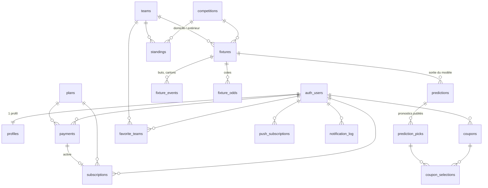

# Winner Pronostic — architecture

Ce document décrit la **base de données**, l'**arborescence du projet** et les **règles de sécurité**.
Le SQL de référence est dans [`supabase/migrations/`](../supabase/migrations).

---

## 1. Schéma de la base de données (Supabase / PostgreSQL)



### Utilisateurs

| Table | Rôle | Colonnes clés |
|---|---|---|
| `profiles` | 1 ligne par compte (créée automatiquement à l'inscription) | `display_name`, `email`, `phone`, `birth_date` (**contrainte ≥ 18 ans**), `country_code`, `role` (`user`/`admin`), préférences de notifications |

### Données football (synchronisées depuis API-Football, phase 2)

| Table | Rôle | Colonnes clés |
|---|---|---|
| `competitions` | Ligues et coupes (id = id API) | `name`, `country_name`, `type`, `current_season`, `is_enabled` (affichée), `is_featured`, `display_order` |
| `teams` | Équipes | `name`, `logo_url`, `elo_rating` (classement Elo du moteur) |
| `fixtures` | Matchs | `kickoff_at`, `status_short`, `status_group` (calculé : scheduled / live / finished / postponed / cancelled), `elapsed`, scores mi-temps et fin |
| `fixture_events` | Buteurs, cartons, remplacements | `minute`, `type`, `detail`, `player_name`, `event_key` (anti-doublon) |
| `standings` | Classements | rang, points, buts pour/contre **domicile et extérieur**, `form` |
| `fixture_odds` | Cotes des bookmakers | `market`, `selection`, `odd` |
| `api_cache` | Cache des réponses brutes de l'API (compos, blessés, H2H) | `cache_key`, `payload`, `expires_at` |
| `sync_runs` | Journal des tâches cron et du quota API | `job`, `status`, `api_requests` |

### Pronostics, historique et coupons (phases 4 et 5)

| Table | Rôle | Colonnes clés |
|---|---|---|
| `predictions` | Probabilités de **tous les marchés** pour un match | `expected_home_goals`, `expected_away_goals` (λ de Poisson), `home_elo`, `away_elo`, `probabilities` (JSON), `inputs` (forme, absences) |
| `prediction_picks` | Pronostics **publiés** = historique public | `market`, `selection`, `probability`, `best_odd`, `implied_probability`, `edge` (value), `confidence` 1–5, `is_premium`, `result` |
| `coupons` | Coupons générés (utilisateur) ou éditoriaux (admin) | `target_odds`, `risk_level`, `period`, `total_odds`, `estimated_probability`, `is_featured` |
| `coupon_selections` | Sélections d'un coupon (1 par match) | `market`, `selection`, `odd`, `probability`, `result` |

Marchés gérés : `1X2`, `DC` (double chance), `OU05`/`OU15`/`OU25`/`OU35` (plus/moins de buts), `BTTS` (les deux équipes marquent), `HTFT` (mi-temps/fin de match).

### Abonnements et paiements (phase 6)

| Table | Rôle | Colonnes clés |
|---|---|---|
| `plans` | Offres (semaine, mois) | `price_xof`, `duration_days`, `is_active` |
| `payments` | Transactions Mobile Money | `provider` (cinetpay/fedapay), `provider_transaction_id` (unique), `amount_xof`, `operator`, `status` |
| `subscriptions` | Périodes premium | `starts_at`, `ends_at`, `status` |

### Favoris, notifications, administration

| Table | Rôle |
|---|---|
| `favorite_teams` | Équipes suivies par l'utilisateur |
| `push_subscriptions` | Abonnements Web Push (un par appareil) |
| `notification_log` | Alertes déjà envoyées (évite les doublons) |
| `app_settings` | Réglages (pronostics gratuits/jour, message de prévention…) |
| `admin_audit_log` | Journal des actions des administrateurs |
| `rate_limits` | Compteurs anti-abus partagés entre instances serverless |

### Fonctions SQL

| Fonction | Usage |
|---|---|
| `is_admin()` / `is_premium()` | Utilisées par les politiques RLS |
| `handle_new_user()` | Déclencheur : crée le profil, **refuse les moins de 18 ans** et l'absence d'acceptation des conditions |
| `protect_published_pick()` | Déclencheur : un pronostic publié ne peut plus être modifié ni supprimé (seul son résultat change) |
| `rate_limit_hit(clé, limite, fenêtre)` | Limitation de requêtes (serveur uniquement) |

## 2. Règles d'accès (Row Level Security)

La RLS est activée sur **toutes** les tables et les droits par défaut de Supabase sont retirés avant d'accorder le strict nécessaire.

| Données | Visiteur | Utilisateur | Premium | Admin | Serveur (clé secrète) |
|---|---|---|---|---|---|
| Matchs, équipes, classements, cotes | lecture | lecture | lecture | lecture | écriture |
| Compétitions | actives | actives | actives | toutes + activer/ordonner | écriture |
| Profil | — | le sien (nom, pays, notifications modifiables ; **rôle et âge non modifiables**) | idem | tous (lecture) | tout |
| Pronostics publiés | gratuits + historique réglé | idem | **tous** | tous | publication, résultats |
| Probabilités détaillées | matchs terminés | idem | tous | tous | écriture |
| Coupons | mis en avant | les siens + mis en avant (suppression des siens) | idem | tous | création |
| Paiements, abonnements | — | les siens (lecture) | idem | tous (lecture) | écriture (webhooks) |
| Favoris, abonnements push | — | les siens (ajout/suppression) | idem | — | lecture pour l'envoi |
| Cache API, compteurs anti-abus | — | — | — | — | tout |

Ces règles sont vérifiées automatiquement par [`tests/db/schema.test.ts`](../tests/db/schema.test.ts).

## 3. Arborescence du projet

```
winner-pronostic/
├── README.md                     installation, configuration, déploiement
├── docs/ARCHITECTURE.md          ce document
├── .env.example                  variables d'environnement (par phase)
├── next.config.ts                Cache Components, en-têtes de sécurité (CSP…)
├── vitest.config.mts             tests
├── public/
│   ├── sw.js                     service worker (hors ligne, push en phase 7)
│   ├── icon-source.svg           logo source
│   └── icons/                    icônes PWA (192, 512, maskable, Apple)
├── scripts/
│   ├── gen-db-types.mjs          génère src/types/database.ts depuis les migrations
│   └── generate-icons.mjs        génère les PNG depuis le SVG
├── supabase/
│   ├── config.toml               CLI Supabase (local)
│   └── migrations/               schéma SQL versionné
├── tests/
│   ├── unit/                     validations, sécurité, (moteur de pronostics en phase 4)
│   └── db/                       migrations + RLS sur PostgreSQL
└── src/
    ├── proxy.ts                  rafraîchit la session, protège /compte et /admin
    ├── app/
    │   ├── layout.tsx            coquille : en-tête, bandeau 18+, navigation du bas
    │   ├── manifest.ts           manifeste PWA
    │   ├── page.tsx              accueil (programme des matchs en phase 2)
    │   ├── (auth)/               connexion, inscription, vérification SMS, mot de passe
    │   ├── auth/confirm/         liens reçus par e-mail
    │   ├── compte/               profil, offre, déconnexion
    │   ├── admin/                espace administrateur (complet en phase 7)
    │   ├── direct/ pronostics/ coupons/        (phases 2 et 4)
    │   ├── jeu-responsable/ conditions/ hors-ligne/
    │   ├── match/[id]/           fiche match (phase 3)
    │   ├── historique/           taux de réussite (phase 5)
    │   ├── premium/              abonnements (phase 6)
    │   └── api/                  cron/*, webhooks/paiement, push (phases 2, 6, 7)
    ├── components/               ui/, layout/, auth/, account/, pwa/, brand/
    ├── lib/
    │   ├── env.ts, env.server.ts variables validées avec zod
    │   ├── supabase/             clients navigateur, serveur, admin, proxy
    │   ├── auth/                 actions serveur, schémas zod, DAL, erreurs
    │   ├── security/             limitation de requêtes, redirections sûres, IP
    │   ├── validation/           téléphone (E.164, Afrique de l'Ouest), âge
    │   ├── football/             client API-Football + cache + synchro (phase 2)
    │   ├── predictions/          Poisson, Elo, marchés, coupons (phase 4)
    │   └── payments/             CinetPay / FedaPay (phase 6)
    └── types/database.ts         types générés de la base
```

## 4. Choix techniques

- **Next.js 16 avec Cache Components** : chaque page a une coquille statique servie immédiatement par le CDN ; seules les parties personnelles (compte, statut premium) arrivent ensuite en streaming. C'est le meilleur compromis pour les connexions lentes.
- **Pas de police téléchargée, icônes SVG en ligne, peu de JavaScript client** : pages légères sur petits téléphones Android.
- **Téléphone d'abord** : l'inscription par numéro (code SMS) est proposée en premier, l'e-mail en second.
- **Validation côté serveur systématique** (zod dans les Server Actions), **RLS** comme deuxième barrière, **limitation des tentatives** partagée en base (SMS coûteux, force brute).
- **Transparence** : les pronostics publiés sont figés par un déclencheur SQL ; l'historique réglé est public, y compris les pronostics premium.
